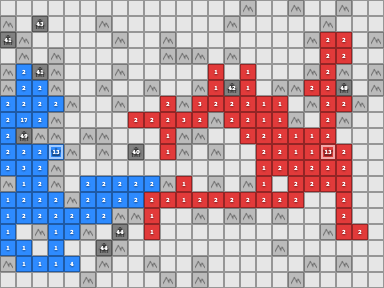
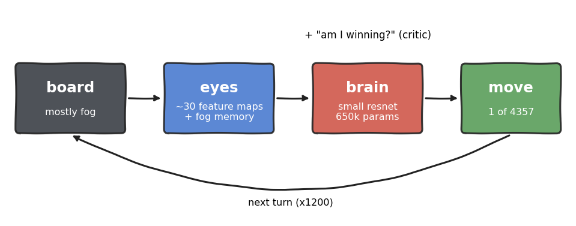
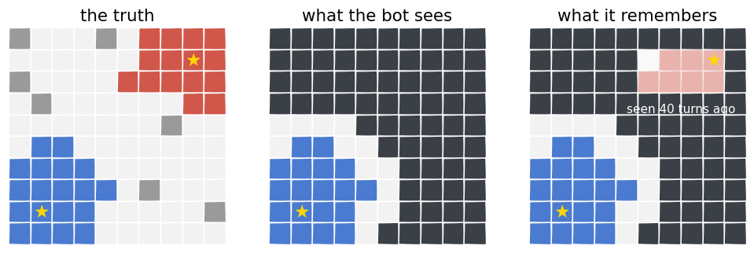
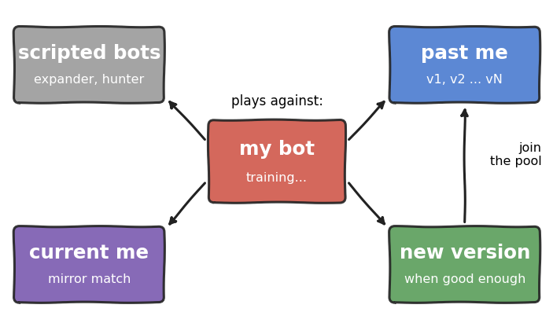
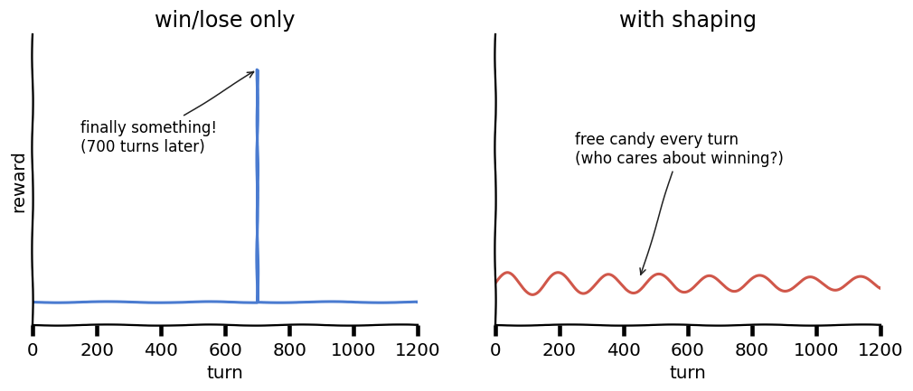

## Generals
https://github.com/giteliot/cwnh-generals

 

    
    
not my bot, sadly

 

### The challenge
[generals.io](https://generals.io): grab land, grow armies, find the enemy general, take him out.
This summer it became a [bot competition](https://generals.bot), with a few twists:
- fog of war: you only see next to your own land
- no free castles, you have to build them
- from turn 800 any hit on the enemy general wins (sudden death!)
- 150ms per turn, or you forfeit

### My approach
Self-play PPO, in JAX, on top of an engine that does 10M+ steps per second. Each turn goes like this:

 

    

 

- **eyes**: ~30 handmade feature maps of the board
- **brain**: a small resnet, picking 1 of 4357 possible moves
- **critic**: guesses who is winning, so PPO knows if a move was good

The fog is the tricky part. A plain network forgets everything the moment it looks away, so the eyes also carry a memory: last seen enemies, castles, and where their general probably is.

 

    

 

For opponents, the bot plays against a pool: scripted bots, itself, and its own past versions. When a new version is good enough, it joins the pool.

 

    

 

<!-- TODO: picture/video of the bot playing -->

### What worked
- Speed. Thousands of games in parallel, even on the free Kaggle GPU.
- The submitted bot runs in pure numpy: 7ms per turn out of 150ms, zero faults.
- Sometimes it beat the best players on the leaderboard!

### What didn't
- ...and then lost stupid games against the base bots. Genius one game, potato the next.
- **The reward.** Games are 1200 turns long, and win/lose comes only at the end. That is almost nothing to learn from. So I added a small bonus for land and income every turn (reward shaping). The bot learned to farm the bonus instead of winning. I never found the sweet spot.

 

    

 

Final result: somewhere around #20 in the 1-week Sprint. With only one week, the free Kaggle GPU, and a few bugs along the way, I couldn't do better. Not bad, not great, very inconsistent.

The real lesson: a 1200-turn game with one reward at the end is _hard_.
