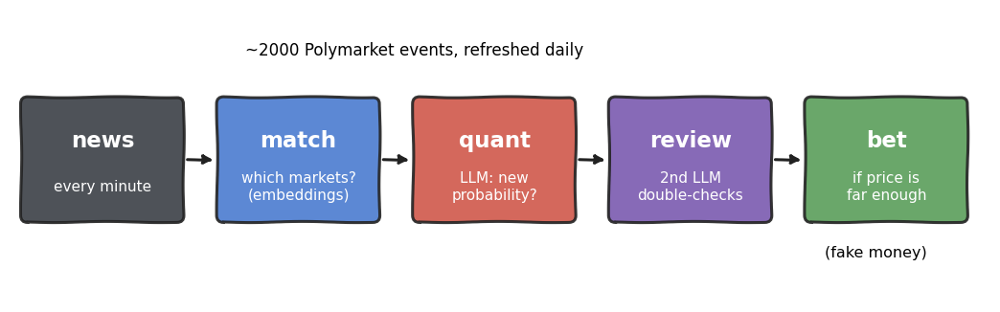
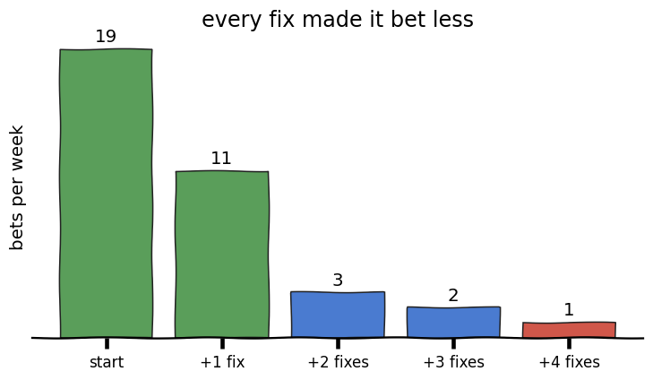

## Polybot

My biggest side project, maybe ever. 8 months, ~80 commits, and a lot of fake money.

### The idea
[Polymarket](https://polymarket.com) lets you bet on real-world events: elections, wars, deals, the Fed.
News moves those prices. So: read the news faster than the market, ask an LLM "what does this change?", bet before everyone else. Easy money, right?

 

    

 

- **news**: RSS feeds, checked every minute
- **match**: embeddings find which of ~2000 open markets a headline is about
- **quant**: a cheap LLM says "the probability is now X" (or "this is already priced in")
- **review**: a bigger LLM double-checks every big move
- **bet**: only if the gap with the market price is large enough. Then sell after 6 hours.

It ran 24/7 on a small server. It never touched real money (thankfully).

### Things I tried
A lot. In short:
- 3 different LLM setups, before landing on the two-step one
- scraping full articles (blocked everywhere, back to headlines only)
- a gate that throws away markets news can't resolve ("how many times will X tweet?")
- giving each market a background brief from Google search (this burned a month of API budget in one day)
- adding the recent price trend, so the model can tell "already priced in"
- hand-labelling 100 news to fix the matching (recall from 67% to 94%)
- ~15 news sources, from Reuters to the White House to TASS

Every fix made the bot more careful. Maybe a bit too careful.

 

    

 

### What worked
The model is actually not bad! On its "direct" calls, it guessed the direction of the price right ~2 times out of 3 in the first hour.

 

    

 

...then the effect fades, and at 12-24 hours it is a coin flip. After fees, the 6-hour exit made about +0.2% per bet. Not exactly retirement money.

Some highlights:
- **The good**: "US-Iran deal signed" at 0.35, right after an "MOU signed" headline. It went to 0.999.
- **The bad**: a full-size bet on "Iran leadership change" after news about Ali Khamenei's funeral. The market was about Mojtaba.
- **The ugly**: betting against Trump suing the WSJ, four times in a row. Lost all four.

### What didn't
The news. Free news is either fast and useless, or useful and late.

 

    

 

Reuters via Google News arrived ~7 hours late (one item: 2 years late). When I traced 23 big price jumps back to their first source, none came first from Reuters. Most came straight from the source: official sites, scheduled announcements, live vote counts. The rest of the fast stuff (like X) costs money.

### The verdict
The model doesn't diverge much from what actually happens. The problem is _when_ it finds out: by the time free news arrives, the market already knows.

Fast news costs money. Without it, there is no edge. Failure? Probably. Fun? Definitely.
