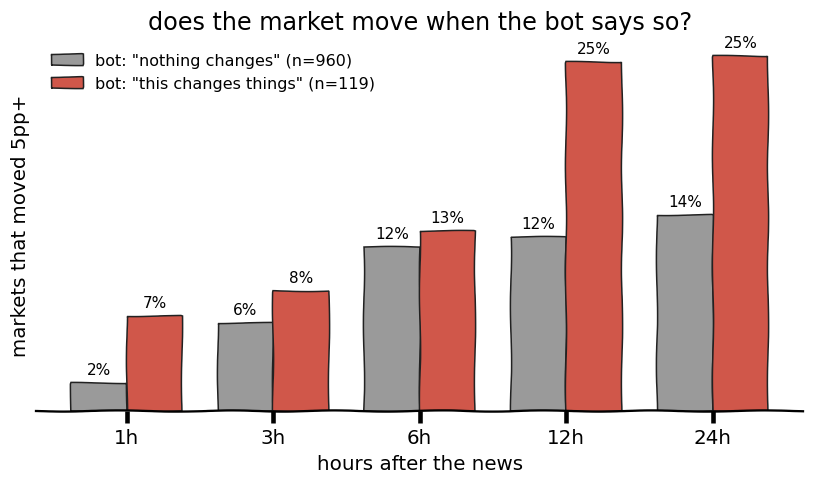
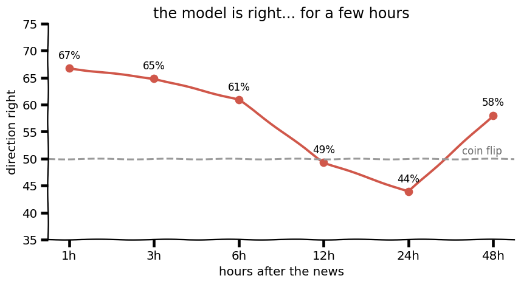
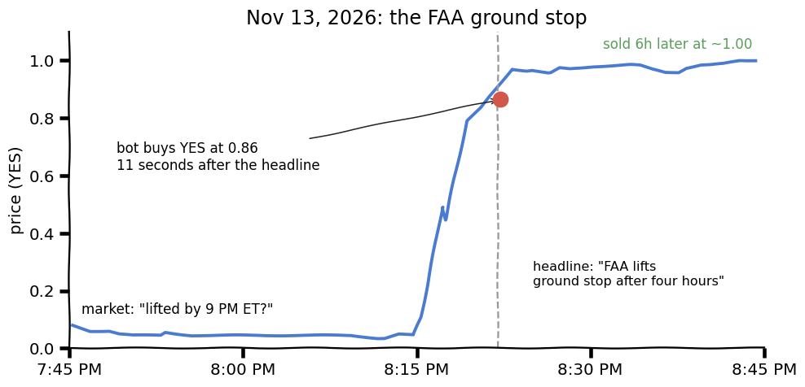
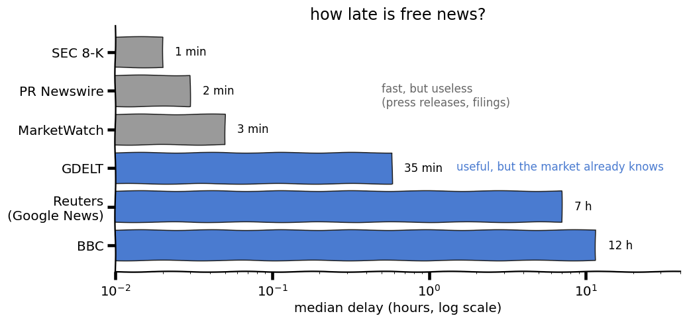
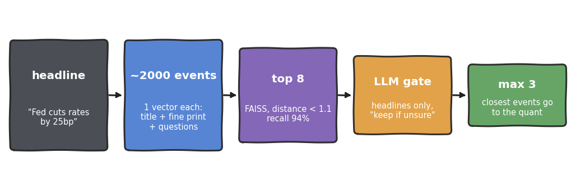
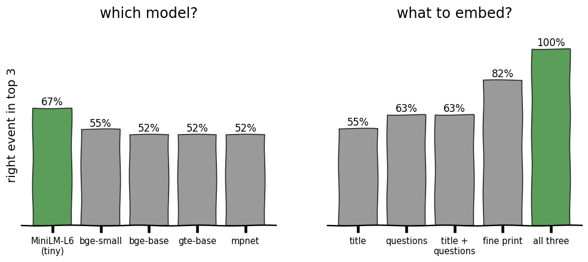
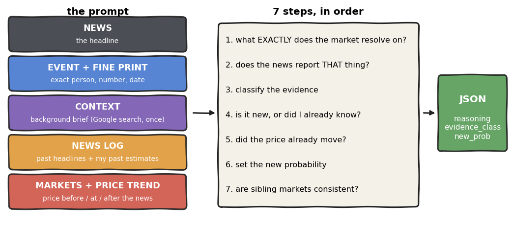
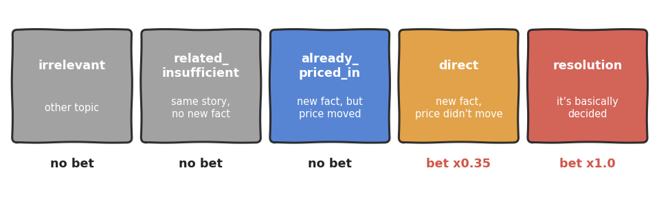
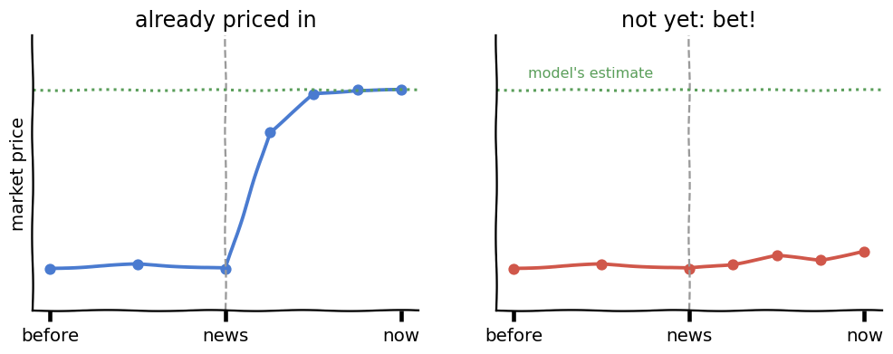

## Polybot

My biggest side project, maybe ever. 8 months, and a lot of fake money.

### The idea
[Polymarket](https://polymarket.com) lets you bet on real-world events: elections, wars, deals, the Fed.
News moves those prices. So: read the news faster than the market, ask an LLM "what does this change?", bet before everyone else. Easy money, right?

 

    

 

- **news**: RSS feeds, checked every minute
- **match**: embeddings find which of ~2000 open markets a headline is about
- **quant**: a cheap LLM says "the probability is now X" (or "this is already priced in")
- **review**: a bigger LLM double-checks every big move
- **bet**: only if the gap with the market price is large enough. Then sell after 6 hours.

It ran 24/7 on a small server. It never touched real money (thankfully).

### Things I tried
A lot. In short:
- 3 different LLM setups, before landing on the two-step one
- scraping full articles (blocked everywhere, back to headlines only)
- a gate that throws away markets news can't resolve ("how many times will X tweet?")
- giving each market a background brief from Google search (this burned a month of API budget in one day)
- adding the recent price trend, so the model can tell "already priced in"
- hand-labelling 100 news to fix the matching (recall from 67% to 94%)
- ~15 news sources, from Reuters to the White House to TASS

Every fix made the bot more careful. Maybe a bit too careful.

 

    

 

### What worked
The model is actually not bad! I checked ~1000 of its calls (Jul-Aug 2026) against the real price history.

When it said **"nothing changes"**, it was mostly right: 98% of those markets stayed within 5 points in the next hour.
When it said **"this changes things"**, the market moved 5+ points about 2x more often, at least in the first hour and after 12 hours.

 

    

 

And when it moved, the direction was right ~2 times out of 3 in the first hour.

 

    

 

...then the effect fades, and at 12-24 hours it is a coin flip. After fees, the 6-hour exit made about +0.2% per bet. Not exactly retirement money.

#### A good one: the FAA ground stop
On Nov 13, a telecom outage grounded every flight in the US. Polymarket immediately opened markets like "will the ground stop be lifted by 9 PM ET?".

At 8:22 PM the headline arrives: _"FAA lifts ground stop after four hours"_. 11 seconds later the bot did the math: four hours from the start puts the lift around 7:54 PM, before 9 PM. Evidence class: `resolution`. The market was at 0.86, so it bought YES.

 

    

 

Result: +11% after fees (ok, $2.19 of fake money). Not the fastest in the room: someone started moving the price 7 minutes before the headline. But the bot read it right, in seconds, and grabbed the last 14 points.

### What didn't
The news. Free news is either fast and useless, or useful and late.

 

    

 

Reuters via Google News arrived ~7 hours late (one item: 2 years late). When I traced 23 big price jumps back to their first source, none came first from Reuters. Most came straight from the source: official sites, scheduled announcements, live vote counts. The rest of the fast stuff (like X) costs money.

### Best (and worst) bets
- **The good**: "US-Iran deal signed" at 0.35, right after an "MOU signed" headline. It went to 0.999.
- **The bad**: a full-size bet on "Iran leadership change" after news about Ali Khamenei's funeral. The market was about Mojtaba.
- **The ugly**: betting against Trump suing the WSJ, four times in a row. Lost all four.

### The verdict
The model doesn't diverge much from what actually happens. The problem is _when_ it finds out: by the time free news arrives, the market already knows.

Fast news costs money. Without it, there is no edge. Failure? Probably. Fun? Definitely.

---

### Technical appendix
For the nerds. The two parts that took most of the 8 months: **finding the right market** and **asking the right question**.

#### 1. Embeddings: which market is this news about?
Every day the bot loads ~2000 Polymarket events. A cheap LLM drops the ones news can't decide ("how many times will X post this week?"). Each survivor becomes **one vector**: title + fine print + all its market questions, embedded with `all-MiniLM-L6-v2` into a FAISS index.

Every headline is embedded the same way and goes down a funnel:

 

    

 

- **Top 8, not top 3.** On 100 hand-labelled news, top 3 found 67% of the right events. Top 8: 94%. Top 10+: nothing more.
- **No distance-only cutoff.** One generic headline matched 154 events.
- **The LLM gate** sees only headlines and market questions, in one batched call. It is lazy on purpose: "keep if unsure". It kept 31/31 correct pairs and dropped half of the noise.
- Then only the **3 closest** events go to the expensive part.

Two surprises from the eval: the tiniest model won, and the boring fine print matters more than the title.

 

    

 

(A cross-encoder reranker was ~15% better at ranking, but precision didn't change. Not worth it.)

#### 2. Prompting: what does this news change?
Two LLMs. A cheap Gemini looks at everything. If it moves a probability by 5+ points, a bigger OpenAI model reviews the call. It can fix the estimate or downgrade the evidence class.

Each call gets one event, with all its markets, and a lot of context:

 

    

 

- **Fine print**: the exact person, number and date the market resolves on. Step 1 exists because of the wrong Khamenei.
- **Context**: a background brief, written once per event with Google search.
- **News log**: what the bot already saw, and what it estimated then. If its past estimates were far from the price and the price never followed, the model must admit the market disagreed.
- **Price trend**: 7 points of the market's own price: 2 before the news, 1 at the news, 4 after.

The answer is always a JSON with a probability and an **evidence class**. This was the single best fix against "vibes" bets (like "SpaceX set to surge +25%"):

 

    

 

The price trend is what separates "already priced in" from "bet!":

 

    
    
a cartoon, not real data

 

Did it work? The "already priced in" markets moved 5+ points only 6% of the time in the next 6 hours, against 13% for "direct". The model can tell when it's late. Sadly, with free news, it's late most of the time.
